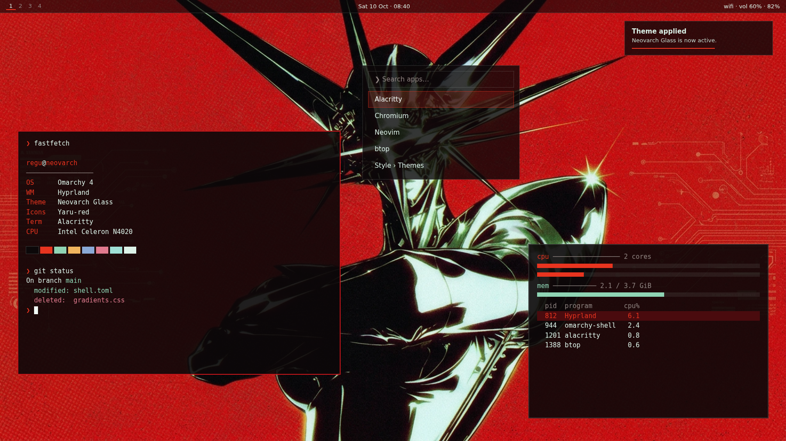

# Neovarch Glass

A dark Omarchy theme in the "liquid glass" style of the
[Boxtop](https://github.com/Maftuuh1922/omarchy-boxtop) bar plugin:
flat translucent near-black tint, 1px hairline borders, a vermilion
Neovarch accent and mint-white text. **No gradients anywhere.**



## Install

From Omarchy: **Install › Style › Themes**, paste the URL, or run:

```bash
omarchy-theme-install https://github.com/Maftuuh1922/omarchy-neovarch-glass-theme
```

That is all. The theme applies immediately: the shell (bar, launcher,
menus, notifications, OSD, lock, polkit), window borders, terminals, btop,
Neovim, Chromium, icons and wallpaper all switch at once. Nothing needs a
reboot or a re-login.

## What's included

| File | What it does |
| --- | --- |
| `colors.toml` | The palette. Omarchy renders every app config from it (Alacritty, Kitty, Ghostty, Foot, btop, Neovim, Helix, Chromium, VS Code, Obsidian, tmux, Hyprland borders). Boxtop reads its `accent` and `background` too, so Boxtop's glass follows the theme with no setup. |
| `shell.toml` | Omarchy shell surfaces as glass: translucent tint (bar 62 %, popups/launcher/notifications ~80 %), 1px mint-white hairline borders, vermilion selection and focus. Every border is one solid colour. |
| `icons.theme` | `Yaru-red` icons. |
| `backgrounds/` | 18 wallpapers, 2560×1440. Default is the red chrome-star halftone; also its darker-edge variant, a noir pair, amber/cobalt/cyan/emerald/pink/violet pairs, and two flat Y2K-star wallpapers. Cycle with the Omarchy background switcher. |
| `preview.png` | Theme picker preview. |

### Palette

| Role | Hex | Contrast on background |
| --- | --- | --- |
| background | `#0c0809` | |
| foreground (mint-white) | `#dcf2e8` | 17.0 : 1 |
| accent (vermilion) | `#e8341f` | 4.7 : 1 |
| muted | `#8f8481` | 5.5 : 1 |
| active window border | `#c1151a` | (UI only) |
| selection | `#4a0b0e` | |

## Optional: window glass (rounded, blurred, translucent windows)

Omarchy deliberately does not let a theme installed from git ship Lua,
so a theme cannot change Hyprland's rounding, blur or window opacity.
The defaults (square corners, no blur, Omarchy's standard terminal
transparency) stay as they are. If you want the full liquid-glass look,
add this to `~/.config/hypr/looknfeel.lua` (it is your config, so it is
kept across theme switches and updates):

```lua
-- Neovarch Glass: optional window glass
hl.config({
  decoration = {
    rounding = 10, -- the Omarchy shell mirrors this, so menus round too
    blur = {
      enabled = true,
      size = 4,
      passes = 1, -- keep it at 1 on low-power CPUs/iGPUs
      new_optimizations = true,
    },
  },
})

-- A little more see-through terminals (active, inactive).
o.transparent_window({ tag = "terminal" }, "0.92 0.86")
```

Save the file; Hyprland reloads it automatically. `preview-glass.png`
shows the result. To undo, delete the block.

## Performance

The theme itself costs nothing: it is colours, two small TOML files and
images. Translucency in the shell is plain alpha blending, no blur. The
optional snippet uses one blur pass at size 4, which stays light even on
an Intel Celeron N4020; skip it entirely on very weak or software-rendered
machines (Omarchy's *no animations* toggle also turns blur off).

## License

MIT. Wallpapers are original artwork made for this theme.
